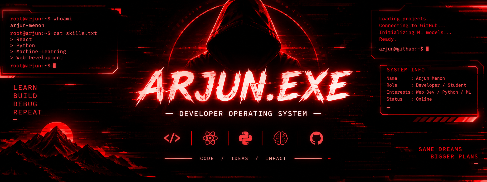

<div align="center">



<br/>

<a href="https://github.com/0xArjun-menon">
  
</a>


<br/><br/>


</div>

---

## `01 // IDENTITY`

```text
┌──[ ARJUN.EXE :: USER PROFILE ]─────────────────────────┐
│                                                        │
│  USER       : Arjun Menon                              │
│  ROLE       : Developer / Student                      │
│  INTERESTS  : Web Development / Python / Machine Learn │
│  APPROACH   : Learn -> Build -> Debug -> Improve       │
│  STATUS     : ONLINE                                   │
│                                                        │
└────────────────────────────────────────────────────────┘
```

Hey! I'm **Arjun Menon** — a developer and student interested in building useful software, exploring frontend development, and learning how machine learning works in practice.

- ⚛️ Exploring React and interactive web experiences.
- 🐍 Working with Python and data-processing workflows.
- 🧠 Learning machine learning concepts and experiments.
- 🛠️ Building projects to turn ideas into practical skills.

> `Curiosity is the source code. Building is the execution.`

## `02 // TECH STACK`

<div align="center">

**LANGUAGES**


**AI / DATA**


**WEB & DEV TOOLS**


</div>

## `03 // PROJECT ARCHIVE`

<table>
  <tr>
    <td width="50%" valign="top">

### ⚛️ React Lab

A frontend project space for exploring React and modern web interfaces.

**Stack:** `React` `JavaScript`

[↗ Browse my repositories](https://github.com/0xArjun-menon?tab=repositories)

    </td>
    <td width="50%" valign="top">

### 🎙️ Speech Logix — Log Viewer

A project focused on viewing and exploring log data.

**Type:** `Software` `Logs`

[↗ Open repository](https://github.com/0xArjun-menon/speech-logix-log-viewer)

    </td>
  </tr>
  <tr>
    <td width="50%" valign="top">

### 🧠 ML Lab

Experiments with data preprocessing, missing values, encoding, scaling, and machine-learning workflows.

**Stack:** `Python` `NumPy` `scikit-learn`

[↗ Open repository](https://github.com/0xArjun-menon/ml-lab)

    </td>
    <td width="50%" valign="top">

### ◈ IEI

A development project and repository to explore.

**Type:** `Development`

[↗ Open repository](https://github.com/0xArjun-menon/iei)

    </td>
  </tr>
</table>

<div align="center">

<a href="https://github.com/0xArjun-menon?tab=repositories">
  
</a>

</div>

## `04 // CURRENT MISSION`

```python
class Arjun:
    interests = [
        "React development",
        "Python programming",
        "Machine learning",
        "Building software projects",
    ]

    motto = "Learn by building."

    def next_step(self):
        return "Keep experimenting. Keep improving."
```

- [ ] Build more complete, practical projects.
- [ ] Strengthen Python and machine-learning fundamentals.
- [ ] Keep exploring modern web development.
- [ ] Learn something new and put it into practice.

## `05 // GITHUB TELEMETRY`

<div align="center">


<br/><br/>


<br/><br/>


</div>

## `06 // CONNECT`

<div align="center">

[](https://github.com/0xArjun-menon)
[](https://github.com/0xArjun-menon?tab=repositories)

```text
[ CONNECTION  : OPEN       ]
[ CURIOSITY   : ACTIVE     ]
[ PROJECTS    : EVOLVING   ]
[ NEXT BUILD  : LOADING... ]
```

<sub>ARJUN.EXE // Every commit is another iteration.</sub>

</div>
